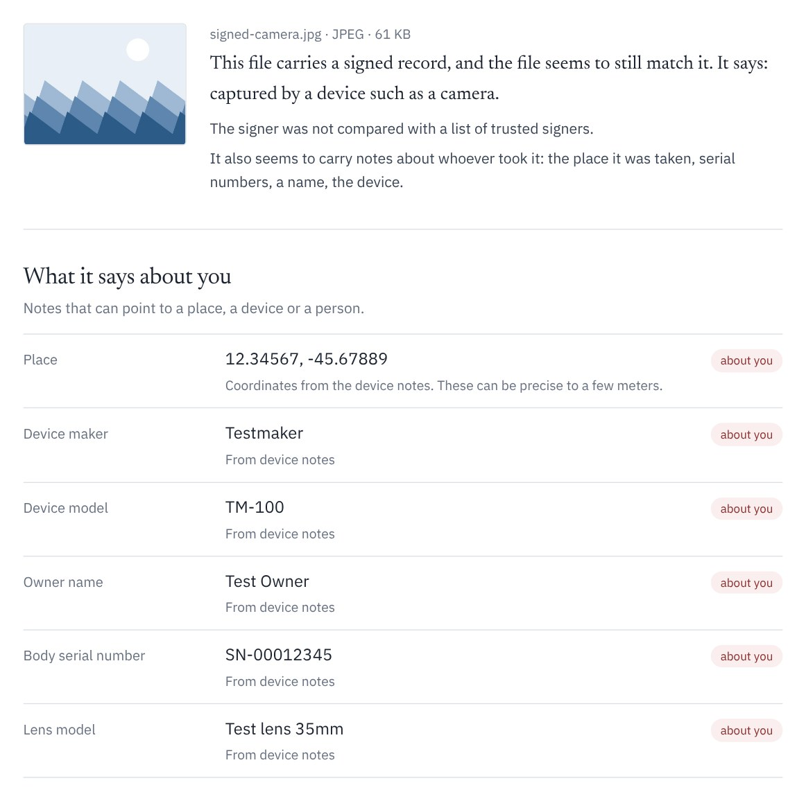

# kunye

kunye reads the notes inside a JPEG or PNG file: where it may have come from, whether a signed record says a model made it, and what it may reveal about the person who took it. It can also save a copy without the notes you choose.

**Use it:** [beratboga.me/kunye](https://beratboga.me/kunye.html)
**Read the post:** [What a photo says about itself](https://beratboga.me/#/blog/what-a-photo-says)



## What it does

Drop a photo on the page and it shows three lists:

1. **Where it came from.** The signed record if there is one, what it declares, and three checks: whether the parts of the record match, whether the file still matches the record, and whether the signature fits the certificate inside it.
2. **What it says about you.** Place, device, serial numbers and names some cameras write.
3. **What it couldn't check.** What it read but could not confirm, and other things found in the file, such as a small preview picture that some files keep inside their notes.

It can then save a clean copy in one of two ways:

- **Remove notes about you:** place, device, serial numbers, names and the small preview. Dates, software and the signed record stay.
- **Remove every note:** also removes the signed record, comments and extra pictures. Color information stays.

In both cases the picture data is copied unchanged, so it is not compressed a second time.

## How to read the result

- A missing note may say very little, because notes can be lost when a file is saved again or shared.
- A plain note is a hint, because it can be edited with little effort.
- When the checks of a signed record pass, the file has likely not changed since signing. Whether the declaration is true, or whether the signer deserves trust, is hard to judge from the file alone. kunye doesn't compare signers with a list of trusted ones.
- Removing notes about you from a signed file changes bytes the record covers, so the record will likely stop matching. kunye warns about this before saving.

## Privacy

Everything runs in the browser. The page is one HTML file with no dependencies, no embedded fonts and no outside requests: its security policy blocks them (`connect-src 'none'`). There is no server, account, tracking or model behind it. Text uses the fonts already on the reader's device.

## What it does not do

- It doesn't look at the pixels, so when a file has no notes it can't help tell a generated image from a photograph.
- It reads JPEG and PNG only. Some phones save photos in other formats by default.
- A clean result means only that kunye found nothing it recognizes.

## What has been tested, and what hasn't

Tested on one computer, in one browser engine:

- the 17 files in `tests/files`, made by the scripts in `tests/`
- both kinds of clean copy for each of them, 34 in all
- the page with the network switched off, and the page's outgoing requests (none were seen)

In the last run, all 17 files were read as expected, and in all 34 clean copies the picture data stayed the same byte for byte while the chosen notes no longer showed up.

Not tested yet: signed files made by real cameras or programs, signature types other than the one used in the tests, other browser engines and phones.

## Files

```
index.html               the whole tool
tests/files/             17 test files and what each should read as
tests/make_test_files.py builds the test files
tests/signer.py          builds the signed records in the test files
tests/make_certs.sh      makes throwaway certificates for signing them
tests/run_tests.py       runs kunye on the test files
tests/run_all.sh         runs everything above in order
docs/                    picture used in this file
```

## Running the tests

The page needs nothing to run. To repeat the tests:

```
sh tests/run_all.sh
```

The script installs the packages listed in `tests/requirements.txt`, makes new throwaway certificates, builds the test files and runs kunye on them. Folders given as arguments are scanned as ordinary images, to look for false alarms. Results are written to `tests/results.json`.

The certificates are made fresh on each run. They are not part of this repository and sign nothing real.

## Corrections

If kunye seems to read a file wrongly, or misses a note, please open an issue. Leave out anything personal from the file you share.

## License

GPL-3.0-or-later. See [LICENSE](LICENSE).
